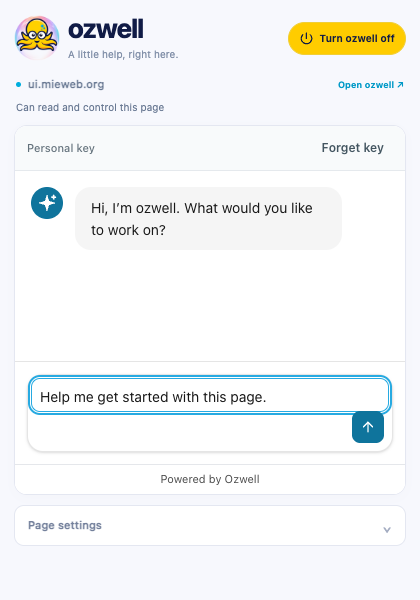
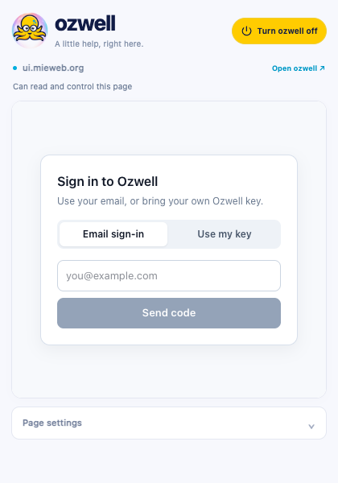
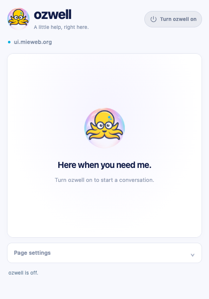
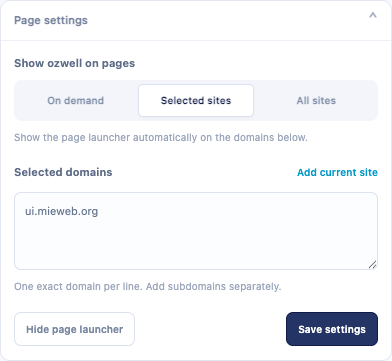
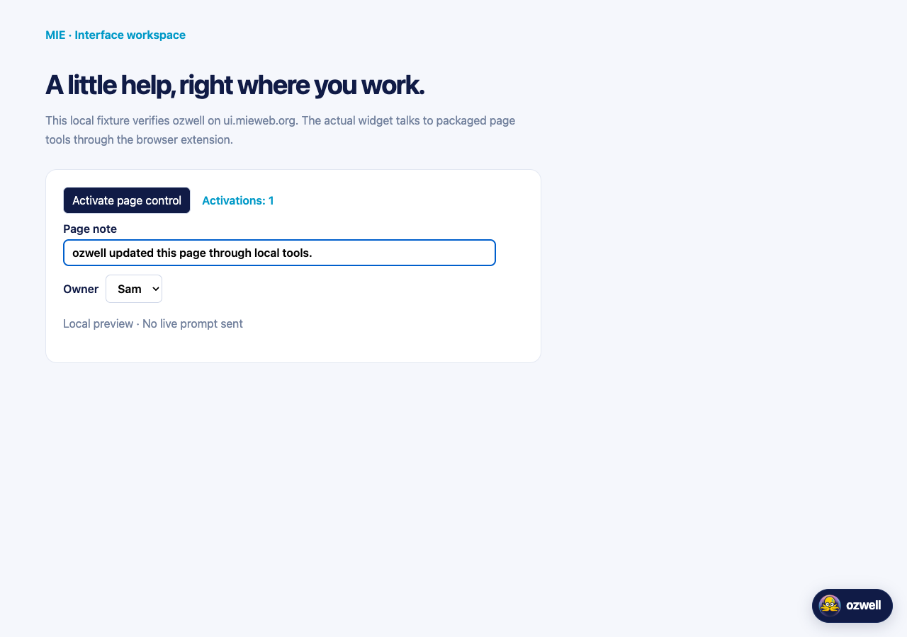
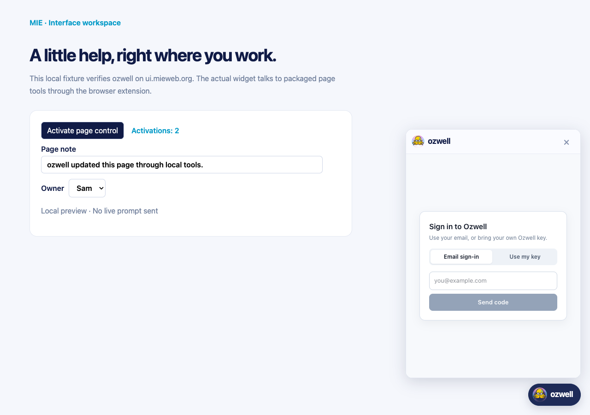
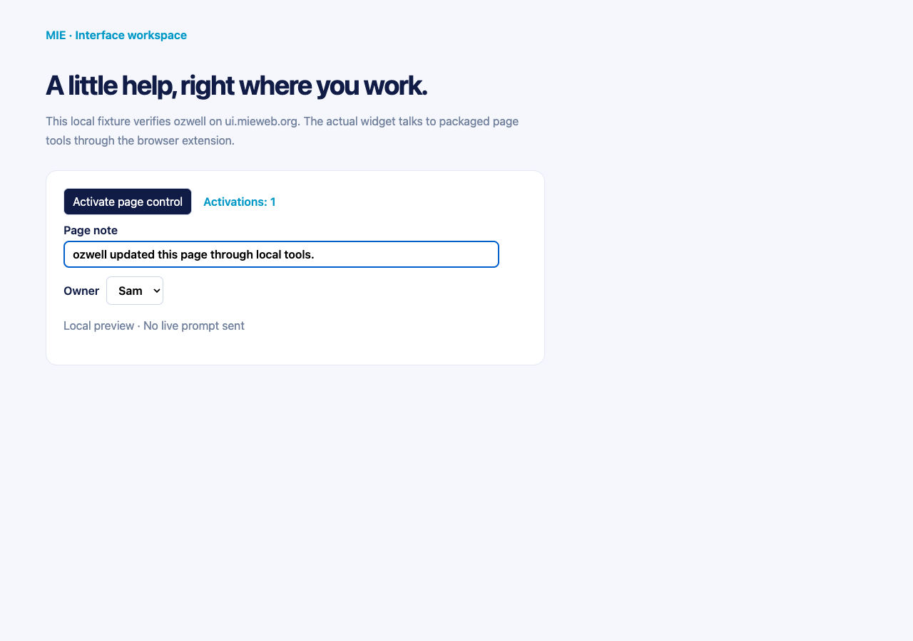

# ozwell preview and page control

[Watch the 30-second install and activation walkthrough](./ozwell-install-activation.mp4).
The recording shows Chrome installation, enabling, and activation using the local preview. Authentication
is demonstrated with test responses; the typed draft is not sent to a live model.
The edited screen recording skips the folder chooser and pauses between actions.
Safari installation is covered in the [packaging instructions](../scripts/README.md).

The screenshots below come from a loaded Chromium extension using the actual
locally built widget. Network routes provide demonstration authentication and an
invented test key. They show the implemented interface, rather than deployed
sign-in or chat. The public widget server still requires the
[deployment updates](../README.md#widget-deployment).

| Toolbar chat | Widget sign-in |
| --- | --- |
|  |  |

Opening the toolbar brings up the widget directly. Once authenticated, the
composer receives focus; the extension never stores the sign-in credential.

| Power off | Page settings |
| --- | --- |
|  |  |

The power button applies immediately and remembers the previous page mode.
**Page settings** contains On demand, Selected sites, and All sites controls;
**Save settings** applies page behavior and requests required permissions.

| Page launcher | Page widget |
| --- | --- |
|  |  |

The floating launcher remains optional. These page screenshots use a local fixture
at `ui.mieweb.org`.

## Page-control validation

The extension is stacked on [#326](https://github.com/mieweb/ozwellai-api/pull/326)
and exposes snapshot, click, fill, select, and scroll tools to both chat entry
points. Opening toolbar chat connects to the original active website even when
the floating launcher is hidden. The popup reports whether page control is
available. Protected browser pages keep ordinary chat.

The browser checks send MCP requests from the actual widget iframe through the
extension bridge into the page controller. These requests use local fixture data;
they do not use a live model. Snapshots can become conversation context when a
real agent requests them. See the [scope and exclusions](../README.md#page-control).

The fixture's counter changes from 0 to 1, its note is filled, and its owner becomes
Sam through the toolbar widget bridge. The “Activate page control” button is a
test-page control. The fabricated private field and private subtree remain visible
on the page; the test asserts that their contents are absent from tool snapshots.

The install video predates page-control integration; it documents the unchanged
installation, branding, and power flow. Page-control validation is documented by
the browser checks and the current screenshots.
